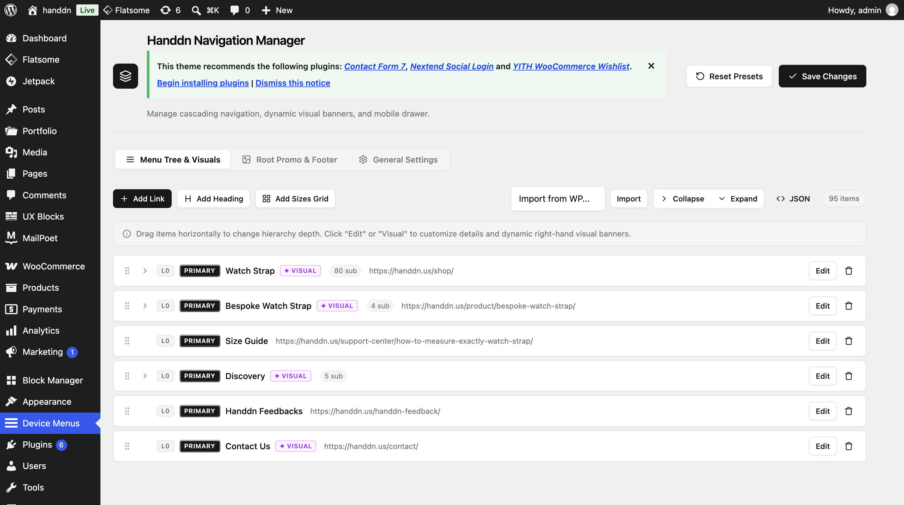
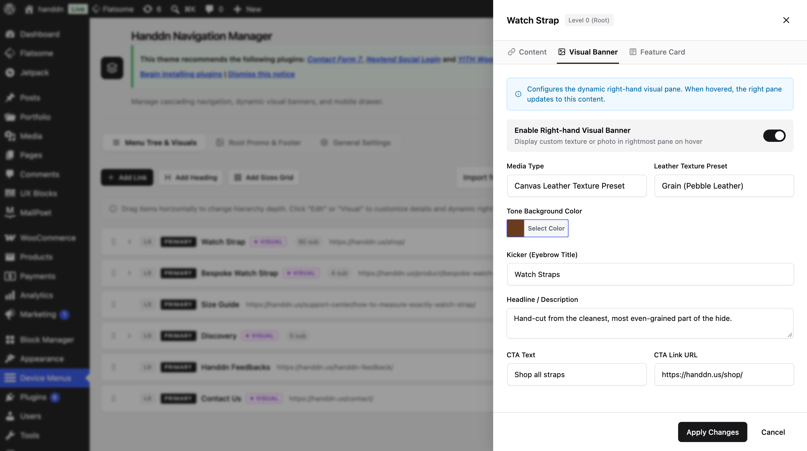
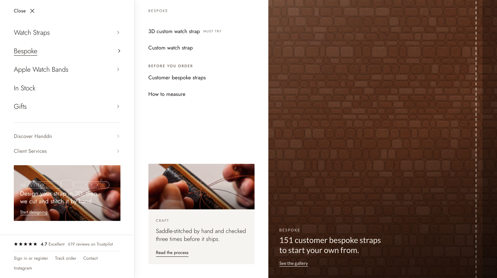
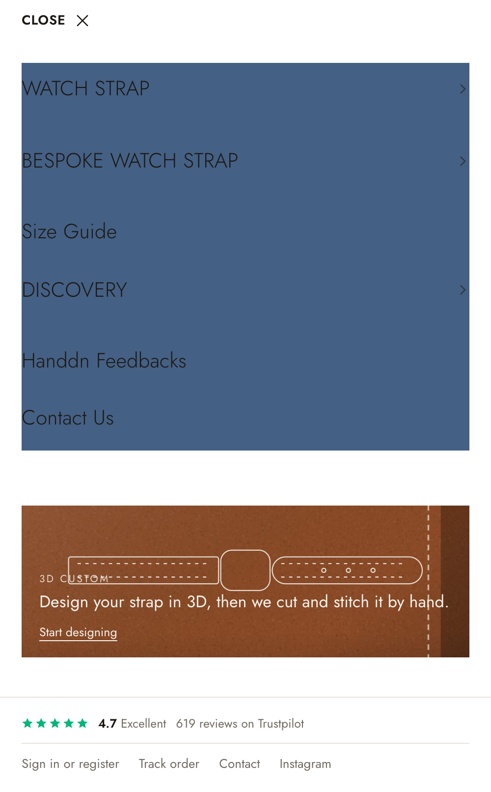

# Hướng Dẫn Sử Dụng & Quản Trị Plugin Device Menu Manager (HandDN Edition)

Tài liệu này dành cho Quản trị viên website (WordPress Administrators) nhằm hiểu rõ toàn bộ cấu trúc, các tuỳ chọn cấu hình trong trang Admin, cách thức menu hiển thị ngoài giao diện thực tế (Frontend), và các bước tích hợp tối ưu nhất.

---

## 1. Tổng Quan & Kiến Trúc Kỹ Thuật

**Device Menu Manager (DMM)** là giải pháp menu dạng trượt đa tầng (Multi-panel Sliding Drawer) được thiết kế theo phong cách tối giản xa xỉ (Luxury Atelier) dành riêng cho HandDN.

### Điểm nổi bật về hiệu năng:
* **0 câu lệnh SQL lặp lại**: Toàn bộ cây phân cấp đa tầng (hơn 75 items) được quản lý và lưu trong 1 bản ghi JSON duy nhất (`dmm_menu_data`).
* **Tương thích hoàn hảo với Caching Plugins**: Hỗ trợ WP Rocket, LiteSpeed Cache, Cloudflare, Redis Object Cache. Cơ chế tự động xóa transient cache ngay khi bấm Save trong Admin.
* **Tự động thích ứng thiết bị (Responsive)**: Hoạt động mượt mà trên cả Desktop (chuỗi 3 panels đẩy từ trái sang phải kèm Visual Banner) và Mobile (các màn trượt kế tiếp kèm nút Back).

---

## 2. Giao Diện Quản Trị Admin (Admin Screen)

Để truy cập bảng điều khiển, vào **WP Admin > Device Menus** (hoặc **Appearance > Device Menus**).



Giao diện quản trị được chia làm 3 tab chức năng chính:

```
┌─────────────────────────────────────────────────────────────────────────────┐
│ Device Menu Manager                                            [Save Changes]│
├─────────────────────┬───────────────────────────┬───────────────────────────┤
│ 1. Menu Builder     │ 2. Drawer & Promo Settings│ 3. Device Overrides       │
└─────────────────────┴───────────────────────────┴───────────────────────────┘
```

---

### TAB 1: Menu Builder (Cây Menu Trực Quan & Side Sheet)

Tab này cho phép dựng, sắp xếp và tùy biến chi tiết từng đường link, danh mục và banner trong cây menu.

#### 1. Thao Tác Kéo Thả & Phân Tầng:
* **Drag & Drop (Kéo thả)**: Bạn có thể kéo thả bất kỳ mục nào để đổi thứ tự hiển thị, hoặc kéo thụt đầu dòng sang phải để biến nó thành Menu con (Child Item).
* **Phân cấp tối đa 3 tầng**:
  * **Level 0 (Root)**: Các mục hiển thị ở panel đầu tiên khi mở menu.
  * **Level 1 (Panel 2)**: Xuất hiện khi bấm vào một mục có menu con ở Level 0.
  * **Level 2 (Panel 3)**: Xuất hiện khi bấm tiếp vào một mục có menu con ở Level 1.
* **Phân vùng Primary & Secondary**:
  * `Primary Navigation`: Nằm ở nửa trên (ví dụ: *Watch Straps, Straps by Brands, Bespoke, Accessories*).
  * `Secondary Navigation`: Tự động được đẩy xuống phía dưới, ngăn cách bởi đường kẻ mỏng tinh tế (ví dụ: *Blog, About HandDN*).

#### 2. Chi Tiết Thuộc Tính Từng Menu Item (Edit Drawer Side Sheet):
Khi bấm vào một item trong cây menu, một ngăn kéo bên phải (Side Sheet) sẽ mở ra:



* **Navigation Section**: Chọn mục này thuộc `Primary Navigation` hay `Secondary Navigation`.
* **Title & URL**: Nhãn hiển thị và liên kết đích khi khách hàng bấm vào.
* **Item Type**:
  * `Link`: Đường link thông thường.
  * `Group Heading`: Tiêu đề nhóm (chữ in hoa nhỏ xám, không có link) dùng để phân loại các danh mục con bên dưới.
  * `Sizes Grid`: Chế độ hiển thị đặc biệt cho các kích thước dây đồng hồ (18mm, 19mm, 20mm, 21mm, 22mm, 24mm...).
* **Custom Badge / Tag**: Nhập các từ khóa tiếp thị nổi bật như `NEW`, `HOT`, `SALE`, `BESPOKE`... Badge sẽ xuất hiện thanh lịch bên cạnh nhãn menu.
* **Visual Banner on Hover (Desktop Banner)**:
  * Khi khách hàng rê chuột vào item này ở cột cuối, panel Visual ngoài cùng bên phải sẽ hiển thị hình ảnh đại diện tương ứng.
  * *Image URL*: Đường dẫn ảnh đại diện (có thể chọn trực tiếp từ Thư viện Media WordPress).
  * *Texture*: Vân nền cao cấp (*Grain, Noise, Paper, Leather*).
  * *Kicker*: Dòng chữ phụ nhỏ bên trên (ví dụ: `COLLECTION`, `EXCLUSIVE`).
  * *Headline*: Tiêu đề chính của banner.
  * *CTA Text & Link*: Nút bấm kêu gọi hành động (ví dụ: `DISCOVER NOW`).
* **Category Highlight Feature Card**:
  * Đặt một thẻ hình ảnh nổi bật ở cuối panel của danh mục đó (rất hữu ích để quảng bá bộ sưu tập nổi bật, ví dụ: "Bespoke Crocodile Straps").

#### 3. Các Phím Chức Năng Thanh Công Cụ (Toolbar):
* **Add Menu Item**: Tạo nhanh một mục menu mới ở cấp ngoài cùng.
* **Import from WP Menu**: Chọn một menu sẵn có trong WordPress (`Appearance > Menus`) và bấm Import để plugin tự động chuyển đổi sang định dạng đa tầng chuẩn của HandDN.
* **JSON Editor**: Dành cho kỹ thuật viên muốn sao chép, backup hoặc dán trực tiếp chuỗi JSON cấu trúc menu.
* **Reset Presets**: Khôi phục lại toàn bộ dữ liệu menu mẫu chuẩn của HandDN Atelier.

---

### TAB 2: Drawer & Promo Settings (Banner Khuyến Mãi & Chân Trang)

Tab này quản lý các thành phần marketing và tiện ích xuất hiện ở Panel gốc (Panel 0).

#### 1. Root 3D Custom Promo Banner:
Nằm ở vị trí danh dự cuối Panel 0, banner này thu hút sự chú ý của khách hàng ngay khi mở menu.
* **Bật/Tắt Banner**: Toggle `Enable Root Promo Card`.
* **Kiểu hình nền**: Chọn giữa `Custom Image` (ảnh tải lên) hoặc `Luxury Texture` (nền vân hạt sang trọng).
* **Tone Color**: Bộ chọn màu chủ đạo (mặc định: `#8a4a26` màu nâu da bò sang trọng).
* **Nội dung chữ**: Kicker (`NEW ARRIVAL`), Headline (`BESPOKE LEATHER`), CTA Button Text (`CUSTOMIZE NOW`), CTA URL.
* **Strap Vector Illustration**: Hiển thị hình minh hoạ dây đồng hồ uốn lượn phong cách Atelier.

#### 2. Drawer Footer & Social Links:
* **Trustpilot 5-Star Reviews Widget**:
  * `Auto Fetch`: Tự động đồng bộ điểm đánh giá từ Trustpilot.
  * Hoặc nhập điểm thủ công (mặc định `4.7` sao từ `619` đánh giá thực tế của khách hàng).
* **WooCommerce Account Link**:
  * Tự động nhận diện trạng thái đăng nhập:
    * Khách vãng lai (Guest): Hiển thị `Sign in or register` dẫn tới trang đăng nhập / đăng ký.
    * Khách đã đăng nhập: Hiển thị `My Account` dẫn tới Dashboard tài khoản cá nhân.
* **Track Your Order**: Liên kết nhanh tra cứu hành trình đơn hàng.
* **Contact & Instagram**: Nút liên hệ và liên kết tài khoản Instagram chính thức của HandDN.

---

### TAB 3: Device Overrides & General Settings

Tab này kiểm soát việc kích hoạt và phạm vi hoạt động của plugin trên toàn website.

* **Master Plugin Toggle**:
  * *Bật*: Plugin hoạt động, nạp CSS/JS và hiển thị menu drawer.
  * *Tắt*: Vô hiệu hóa toàn bộ plugin ngay lập tức. Website sẽ quay lại sử dụng menu mặc định của theme Flatsome mà không làm mất dữ liệu đã cấu hình trong plugin.
* **Desktop Override**: Bật/tắt việc thay thế menu trên màn hình máy tính (>= 850px).
* **Mobile Override**: Bật/tắt việc thay thế menu trên màn hình di động (< 850px).
* **Mobile Breakpoint**: Ngưỡng chia kích thước màn hình responsive (mặc định: `849px` - chuẩn của Flatsome Theme).

---

## 3. Giao Diện & Trải Nghiệm Người Dùng (Frontend Experience)

### Cơ Chế Đẩy 3 Cột Từ Trái Sang Phải (Left-to-Right Push):
Khi khách hàng bấm vào biểu tượng Hamburger trên thanh Header:



1. **Panel 0 (Root Panel)** xuất hiện ở cạnh trái với danh sách danh mục chính, Banner Bespoke và đánh giá Trustpilot.
2. Khi khách click vào danh mục có cấp con (ví dụ: *Watch Straps*):
   * **Panel 1** trượt từ trái sang phải (`transform: translateX(-100%)` thành `translateX(0)` với thời gian trượt mượt mà 1.06 giây).
3. Khi click tiếp vào một danh mục sâu hơn (ví dụ: *Apple Watch Straps*):
   * **Panel 2** tiếp tục trượt từ trái sang phải, tạo thành bố cục 3 cột đồng đều, tinh xảo.
4. **Visual Banner (Cột ngoài cùng)**:
   * Chạy song song và trượt từ trái sang phải sau khi panel nội dung hoàn tất, hiển thị ảnh chụp thực tế của mẫu dây đồng hồ tương ứng.
5. Khi người dùng bấm chuyển sang nhánh khác:
   * Panel cũ và Visual Banner tự động thu gọn về trước (600ms) rồi nhánh mới mới trượt ra, loại bỏ hoàn toàn hiện tượng giật lắc hay chồng chéo hình ảnh.

### Giao Diện Trên Thiết Bị Di Động (Mobile Drawer):
Trên màn hình điện thoại dưới 850px, menu tự động thích ứng thành dạng trượt ngang gọn gàng:



* Cột 1 trượt mượt mà lấp đầy màn hình điện thoại.
* Mỗi panel con đều có thanh tiêu đề kèm nút quay lại (`< Watch Straps`) để khách hàng dễ dàng chuyển hướng.
* Tích hợp thanh tìm kiếm sản phẩm nhanh (Instant Search Sheet) và các liên kết tài khoản tiện lợi.

---

## 4. Hướng Dẫn Kích Hoạt Trên Website Đang Có Menu Cũ

Nếu website WordPress của bạn đã có sẵn menu chính trong `Appearance > Menus`, bạn có thể kích hoạt plugin này theo 3 kịch bản:

### Kịch Bản 1: Giữ menu cũ của Theme, dùng plugin cho nút Menu Drawer (Khuyên dùng)
* Trong **Tab 3: Device Overrides**, bật `Master Plugin Toggle = ON`.
* Chọn nguồn dữ liệu là `Custom JSON`.
* Plugin sẽ tự động gắn vào biểu tượng Hamburger / Menu Icon trên Header của Flatsome hoặc bất kỳ nút nào có class `.nav-top-link` hoặc thuộc tính `data-open="#main-menu"`.
* Khách hàng vừa thấy menu dạng thanh ngang của theme, vừa có thể bấm vào Menu Hamburger để chiêm ngưỡng Menu trượt đẳng cấp của HandDN.

### Kịch Bản 2: Chuyển toàn bộ dữ liệu từ Menu WordPress cũ sang Plugin
* Vào **Tab 1: Menu Builder**.
* Tại thanh công cụ phía trên, tìm mục **Import from WP Menu**.
* Chọn menu WordPress bạn muốn chuyển (ví dụ: `Main Navigation (EN)`).
* Bấm nút **Import**. Hệ thống sẽ tự động đọc toàn bộ cấu trúc cha/con, link, nhãn và tạo thành cây menu trong plugin.
* Tinh chỉnh thêm các nhãn Badge (`HOT`, `NEW`) và ảnh Visual Banner, sau đó bấm **Save Changes**.

### Kịch Bản 3: Gọi Menu Drawer từ nút bấm bất kỳ trong Flatsome UX Builder / Elementor
Bạn có thể mở menu này từ bất kỳ nút bấm, banner hoặc đoạn văn bản nào trên trang bằng cách thêm class sau vào thẻ HTML:
```html
<a href="#" class="hm-open-trigger">Khám Phá Danh Mục</a>
```
Hoặc liên kết:
```html
<a href="#main-menu">Mở Menu</a>
```

---

## 5. Hiệu Năng & Cơ Chế Hoạt Động Cùng Plugin Cache (FAQ)

### Câu hỏi: "Ở site Production có cài plugin tăng tốc (WP Rocket, LiteSpeed Cache, Cloudflare) thì có bị nghẽn CPU khi nhiều người vào cùng lúc không?"

**Trả lời: Hoàn toàn KHÔNG bị nghẽn. Website sẽ chạy cực nhanh và chịu tải hàng chục ngàn khách truy cập cùng lúc.**

Cơ chế hoạt động cụ thể:

1. **Khách vãng lai (Guest Visitors - Chiếm 90-95% lượng truy cập e-commerce):**
   * Các plugin tăng tốc như WP Rocket hay LiteSpeed Cache sẽ lưu toàn bộ mã HTML của trang (bao gồm cả mã HTML của Menu Drawer) vào bộ nhớ RAM hoặc ổ cứng SSD thành các file HTML tĩnh.
   * Khi 1.000 hoặc 10.000 khách vào cùng lúc, máy chủ web (Nginx/LiteSpeed/Cloudflare CDN) sẽ gửi trực tiếp file HTML tĩnh cho khách trong **5ms - 15ms**.
   * **PHP và MySQL hoàn toàn KHÔNG phải chạy lại vòng lặp menu.**

2. **Khách đã đăng nhập (Logged-in Customers):**
   * Với khách đã đăng nhập (bị bỏ qua Full Page Cache), plugin DMM sử dụng **WordPress Transient Cache** (`dmm_drawer_html_logged_in`).
   * Mã HTML của menu được lưu sẵn trong bộ nhớ đệm (Redis/Memcached). PHP chỉ đọc một chuỗi HTML duy nhất đã render sẵn ra ngoài mà không cần duyệt lại mảng 75 items. Thời gian xử lý chỉ **< 1ms**.

3. **Khi bạn chỉnh sửa menu trong Admin:**
   * Ngay khi bấm **Save Changes**, plugin sẽ tự động xoá toàn bộ transient cache (`dmm_drawer_html_*`) và kích hoạt lệnh xóa cache của WP Rocket (`rocket_clean_domain()`) cũng như `wp_cache_flush()`.
   * Khách hàng vào trang sẽ lập tức nhìn thấy nội dung menu mới nhất mà quản trị viên không cần phải bấm xoá cache thủ công.

---

*Tài liệu được biên soạn bởi Đội ngũ Kỹ thuật HandDN Atelier. Mọi thắc mắc xin liên hệ bộ phận phát triển.*
